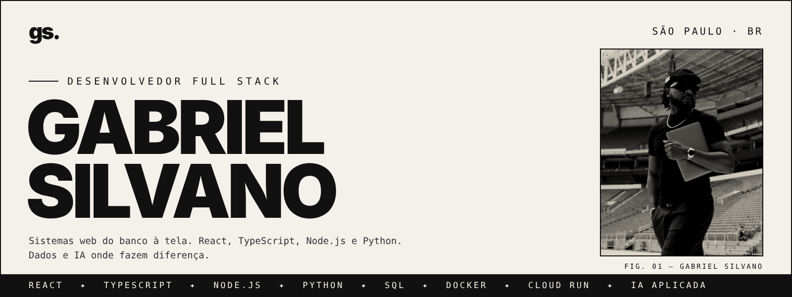
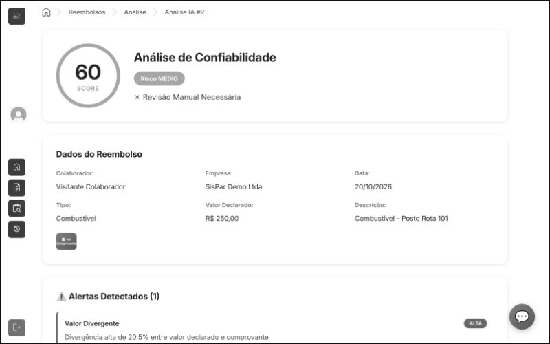
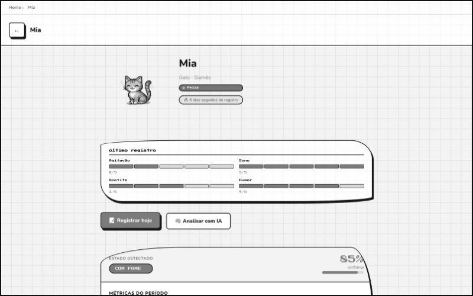
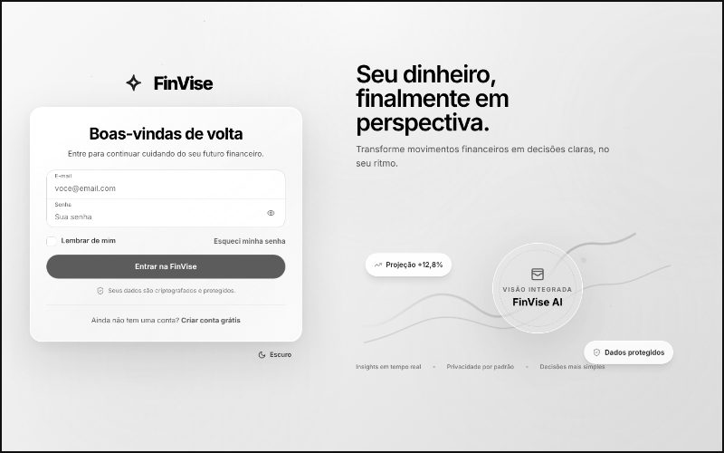
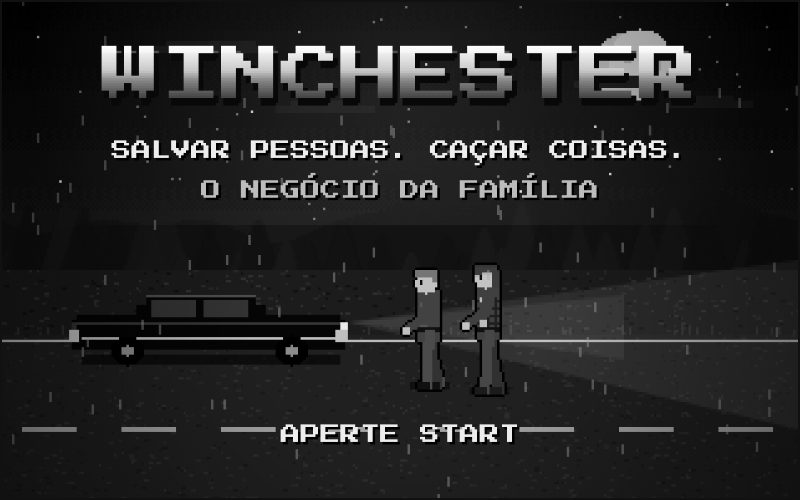
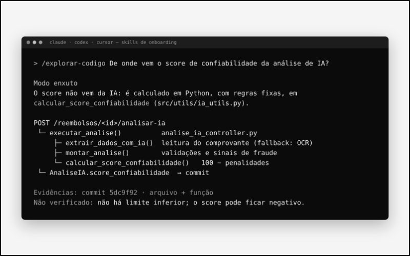

<a href="https://gabrielsilvano.pages.dev">
  
</a>

<br>

<p>
  <a href="https://gabrielsilvano.pages.dev"><b>PORTFÓLIO ↗</b></a> &nbsp;·&nbsp;
  <a href="https://linkedin.com/in/gabriel-silvano-vieira"><b>LINKEDIN ↗</b></a> &nbsp;·&nbsp;
  <a href="mailto:gabrielsilvanovieira7@gmail.com"><b>E-MAIL ↗</b></a>
</p>

Dev Full Stack na **Uiara Amazon Xperience** e dados na **Stone**. Construo sistemas que resolvem problemas de operação: transformar planilha, retrabalho e decisão no escuro em sistema simples de usar, com regra de negócio clara e dado confiável. A IA entra onde faz diferença; a decisão fica em código testado.

<br>

### `(01)` &nbsp;Teste ao vivo

<sub>Login de demonstração, sem cadastro. Dados fictícios.</sub>

<table>
  <tr>
    <td width="50%" valign="top">
      <a href="https://sispar.gabrielsilvanovieira7.workers.dev"></a>
      <br><br>
      <b>SISPAR</b> &nbsp;<sub><code>2025</code></sub><br>
      <sub>Reembolsos corporativos. A IA de visão lê o comprovante; o código valida valor, data e categoria e gera um score de confiabilidade. Login por perfil e chatbot.</sub><br>
      <sub><code>React</code> <code>Flask</code> <code>PostgreSQL</code> <code>Docker</code> <code>Cloud Run</code></sub><br><br>
      <a href="https://sispar.gabrielsilvanovieira7.workers.dev"><b>Abrir ↗</b></a> &nbsp;
      <a href="https://github.com/Gabrielsvdata/Sispar-Backend">API</a> &nbsp;
      <a href="https://github.com/Gabrielsvdata/Sispar-Frontend">Front</a>
    </td>
    <td width="50%" valign="top">
      <a href="https://petmind-front.gabrielsilvanovieira7.workers.dev"></a>
      <br><br>
      <b>PETMIND</b> &nbsp;<sub><code>2026</code></sub><br>
      <sub>Comportamento de pets. A API calcula métricas e tendências; a IA só escreve o diagnóstico. Testes automatizados e typecheck estrito.</sub><br>
      <sub><code>React</code> <code>FastAPI</code> <code>PostgreSQL</code> <code>JWT</code> <code>Cloud Run</code></sub><br><br>
      <a href="https://petmind-front.gabrielsilvanovieira7.workers.dev"><b>Abrir ↗</b></a> &nbsp;
      <a href="https://github.com/Gabrielsvdata/Petmind">API</a> &nbsp;
      <a href="https://github.com/Gabrielsvdata/Petmind-Front">Front</a>
    </td>
  </tr>
</table>

<br>

### `(02)` &nbsp;Projetos selecionados

<table>
  <tr>
    <td width="50%" valign="top">
      <a href="https://github.com/No-Country-simulation/G9-BR-Team-17-FinVise"></a>
      <br><br>
      <b>FINVISE</b> &nbsp;<sub><code>2026</code></sub><br>
      <sub>Plataforma de inteligência financeira, <b>finalista do hackathon Oracle (No Country)</b>. Todo o front-end e a identidade visual foram meus.</sub><br>
      <sub><code>React 19</code> <code>TypeScript</code> <code>Tailwind</code> <code>TanStack Query</code></sub><br><br>
      <a href="https://github.com/No-Country-simulation/G9-BR-Team-17-FinVise"><b>Código ↗</b></a>
    </td>
    <td width="50%" valign="top">
      <a href="https://gabrielsvdata.itch.io/winchester"></a>
      <br><br>
      <b>WINCHESTER</b> &nbsp;<sub><code>2026</code></sub><br>
      <sub>Fan game beat 'em up em pixel art. Personagens, animações e trilha gerados em código, sem engine nem imagens.</sub><br>
      <sub><code>JavaScript</code> <code>Canvas</code> <code>Web Audio</code></sub><br><br>
      <a href="https://gabrielsvdata.itch.io/winchester"><b>Jogar ↗</b></a> &nbsp;
      <a href="https://github.com/Gabrielsvdata/winchester">Código</a>
    </td>
  </tr>
  <tr>
    <td width="50%" valign="top">
      <a href="https://github.com/Gabrielsvdata/dev-onboarding-skills"></a>
      <br><br>
      <b>SKILLS DE ONBOARDING</b> &nbsp;<sub><code>open source</code></sub><br>
      <sub>Kit para Claude Code, Codex e Cursor ajudarem devs recém-chegados a entender sistemas que não conhecem, sempre com evidência.</sub><br>
      <sub><code>Agent Skills</code> <code>Bash</code> <code>ripgrep</code></sub><br><br>
      <a href="https://github.com/Gabrielsvdata/dev-onboarding-skills"><b>Código ↗</b></a>
    </td>
    <td width="50%" valign="top">
      <a href="https://club-sette-web.vercel.app"></a>
      <br><br>
      <b>CLUB SETTE</b> &nbsp;<sub><code>projeto vendido</code></sub><br>
      <sub>E-commerce desenvolvido sob encomenda e entregue ao cliente: loja, filtros e painel administrativo de estoque.</sub><br>
      <sub><code>React</code> <code>TypeScript</code> <code>Supabase</code></sub><br><br>
      <a href="https://club-sette-web.vercel.app"><b>Ver loja ↗</b></a>
    </td>
  </tr>
</table>

<sub>Também: <a href="https://github.com/Gabrielsvdata/doacao-solidaria-backend"><b>Doação Solidária</b></a>, API Node.js/Express que prioriza doações para as instituições mais urgentes.</sub>

<br>

### `(03)` &nbsp;Stack

```text
FRONT-END   React · TypeScript · JavaScript · Tailwind CSS · TanStack Query
BACK-END    Node.js · Express · Python · Flask · FastAPI · APIs REST · JWT
DADOS       PostgreSQL · MySQL · SQLite · SQL · Metabase
INFRA       Docker · Google Cloud Run · Cloudflare · GitHub
IA          LLMs via Groq · Claude Code · Cursor · Codex
```

<br>

### `(04)` &nbsp;Como os projetos ficam no ar

<sub>Backend em Docker no <b>Google Cloud Run</b> com deploy contínuo a cada push · PostgreSQL no <b>Neon</b> · IA via <b>Groq</b> · frontend na <b>Cloudflare</b>.</sub>

<br><br>

<p align="right"><sub><code>gs.</code> &nbsp;São Paulo · BR</sub></p>
